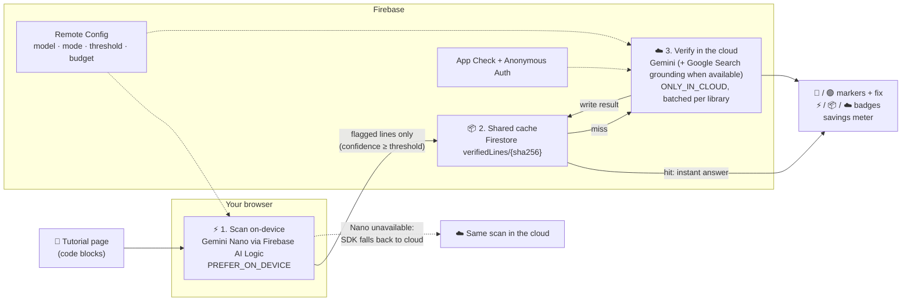

# ⏳ Tutorial Time-Machine

**A Chrome extension and web app that warn you, while you read, when a coding tutorial's code is outdated, and show the modern fix right next to the line.**

Built for **#BuildHybridAI 2026** on **Firebase AI Logic hybrid inference**: Gemini Nano reads every code block on your device, and Gemini in the cloud verifies only the few lines that need it (with Google Search grounding when it's available; see [Cloud verification and Google Search](#cloud-verification-and-google-search)).

- **Live web app:** https://tutorial-time-machine.web.app ([open the Firebase demo directly](https://tutorial-time-machine.web.app/?demo=firebase-v8-firestore))
- **Demo tutorial pages for the extension:** https://tutorial-time-machine.web.app/tutorials/firebase-v8-firestore.html
- **Chrome extension (ready to install):** [download the latest release](https://github.com/Ruwiysis/tutorial-time-machine/releases/latest/download/tutorial-time-machine-extension.zip) (see [Install the extension](#install-the-extension-1-minute))
- **License:** [Apache-2.0](LICENSE)

## Install the extension (1 minute)

1. [Download the zip](https://github.com/Ruwiysis/tutorial-time-machine/releases/latest/download/tutorial-time-machine-extension.zip) and **unzip** it into a folder.
2. In desktop Chrome (139+), open `chrome://extensions` and turn on **Developer mode** (top right).
3. Click **Load unpacked** and choose the unzipped folder (the one that contains `manifest.json`).
4. Pin **Tutorial Time-Machine** from the 🧩 menu, then open a demo tutorial: https://tutorial-time-machine.web.app/tutorials/firebase-v8-firestore.html
5. Click the hourglass icon → **Open side panel**. Outdated lines get 🔴 markers on the page; click one for the fix.

For the on-device scan, Chrome needs Gemini Nano (see [On-device Gemini Nano](#on-device-gemini-nano)). Without it, the scan runs in the cloud and the badges show ☁️ instead of ⚡.

The released build talks to this project's Firebase backend using a dedicated App Check **debug token** (reCAPTCHA can't run inside an extension). It's separate from the web app's and will be revoked after judging.

---

## The problem

Tutorials, blog posts and Q&A answers are written against the library version of their day, and they stay on the web for years. The code still looks right, but it no longer runs:

| Tutorial says | Today it's | What happens |
|---|---|---|
| `firebase.initializeApp(config)` / `firebase.firestore().collection('x')` (Firebase JS v8) | `initializeApp(config)` / `collection(getFirestore(app), 'x')` (modular v9+) | `firebase is not defined`, or a much larger bundle via the compat layer |
| `ReactDOM.render(<App />, root)` (React 17) | `createRoot(root).render(<App />)` | Removed in React 19 |
| `openai.Completion.create(engine="text-davinci-003", …)` (openai-python 0.x) | `client.chat.completions.create(model=…)` | `APIRemovedInV1`, and the model is retired |
| `tf.Session()`, `tf.placeholder(...)` (TensorFlow 1.x) | Eager execution, `tf.function` | `AttributeError: module 'tensorflow' has no attribute 'Session'` |

Developers usually discover this only after copying the code and debugging the error. Tutorial Time-Machine marks the outdated lines while you read, and gives you the modern version.

## How it works: the hybrid pipeline



Every result in the UI shows which path produced it (**⚡ On-device**, **📦 Cache**, **☁️ Cloud**), and a savings meter sums it up: *"51 lines scanned on device · 0 sent to cloud · 13 served from cache"*.

### Why each step runs where it does

| Step | Runs | Why |
|---|---|---|
| **1. Scan** every line, find the library and the version-sensitive calls | **On-device** (Gemini Nano, `PREFER_ON_DEVICE`) | **Cost:** free, however many pages you read. **Privacy:** the page never leaves your machine. **Latency:** no network round trip. Most code (variables, loops, DOM calls) is filtered out here. |
| **2. Look up** lines someone already verified | **Firestore cache** | The same outdated line appears in thousands of tutorials. Once one reader has it verified, everyone after gets the answer instantly with **no model call at all**. |
| **3. Verify** "is this API still current, and what replaces it?" | **Cloud** (Gemini, `ONLY_IN_CLOUD`, Google Search grounding when available) | **Fresh knowledge:** Nano's knowledge is frozen at training time and it can't use tools, so it can't know about a release from last month. In testing, Nano even called `firebase.firestore()` "modern". So the scan only *points at* lines, and the cloud model checks them against today's docs. It only ever sees a handful of flagged lines, never the page. |

### Cloud verification and Google Search

Cloud verification: flagged lines are checked by Gemini in the cloud through Firebase AI Logic. Google Search grounding is built in: when it’s available, Gemini checks each line against the latest documentation and shows its sources. When grounding is unavailable, the app falls back to Gemini’s own knowledge and labels the result clearly, so the user always knows where an answer came from.

> **Status of the live demo:** it runs on Firebase's free tier, where Google Search grounding isn't available for current Gemini models. So the demo's cloud answers come from Gemini's own knowledge and are labeled **"no Search"** on every badge and fix card. With a billing-enabled project, the same code shows the sources and Google's Search suggestions, with no code changes ([`verify.ts`](packages/core/src/verify.ts), [`grounding.ts`](packages/core/src/grounding.ts)).

The hybrid decisions are commented where they're made: [`models.ts`](packages/core/src/models.ts) (inference modes and the echo-stub override), [`scan.ts`](packages/core/src/scan.ts) (what the on-device step returns and what goes on), [`verify.ts`](packages/core/src/verify.ts) (cache-first, batching, per-page budget, grounding fallback) and [`pipeline.ts`](packages/core/src/pipeline.ts) (the three steps end to end).

### Measured on the Firebase demo tutorial (51 lines of code, 6 blocks)

| | First reader | Second reader |
|---|---|---|
| ⚡ On-device scan | 1 prompt, ~16–29 s on a laptop GPU, 13 lines flagged | same (free, private) |
| 📦 Cache | 0 hits | **13 hits, ~1 s** |
| ☁️ Cloud | 13 lines in **2 requests** | **0 requests** |

## Features

- **Chrome extension:** markers appear next to outdated lines on any page with code (🟡 checking, 🔴 outdated, 🟢 current). Click one for an old-vs-modern diff, the explanation, the sources and **Copy fix**. The side panel shows the three steps live, the savings meter and every result. The popup has an on/off switch, Gemini Nano status and lifetime savings.
- **Web app** (for anyone without the extension): pick one of four demo tutorials or paste code, and the same pipeline runs with the same components.
- **Graceful fallbacks, always visible:**
  - No Nano: the SDK sends step 1 to the cloud, and the UI says so (☁️ instead of ⚡).
  - A Chromium build whose Prompt API only echoes the prompt back is detected, and step 1 is routed to the cloud (see [`device.ts`](packages/core/src/device.ts)).
  - Google Search grounding out of quota: the line is still checked without Search, labeled **"no Search"**, and cached under a separate key so a Search-verified answer can replace it later.
- **Tunable without a redeploy:** the cloud model, the scan's inference mode, the confidence threshold, the per-page cloud budget and the tracked libraries all live in **Remote Config**. We switched cloud models twice during development without shipping code.

## Firebase products used

| Product | How it's used |
|---|---|
| **Firebase AI Logic** (`firebase/ai`) | Gemini Developer API backend. **Hybrid inference:** the scan model uses `InferenceMode.PREFER_ON_DEVICE` with `onDeviceParams` (JSON `responseConstraint`) and `inCloudParams` (`responseSchema`). The verify model uses `ONLY_IN_CLOUD` with the `googleSearch` tool. `initializeDeviceModel()` powers the Nano download button. `inferenceSource` on each response drives the ⚡/☁️ badges. Requests use limited-use App Check tokens. |
| **App Check** | Required by AI Logic. The web app uses **reCAPTCHA Enterprise**. Localhost and the Chrome extension use **debug tokens** (reCAPTCHA can't run inside an extension), each with its own revocable token. |
| **Authentication** | Anonymous sign-in, so cache entries record who created them (`createdBy == request.auth.uid` in the rules). The extension uses Firebase's `firebase/auth/web-extension` build, which loads no remote code (a Manifest V3 requirement). |
| **Cloud Firestore** | The shared cache `verifiedLines/{sha256}`: public read, create-only with schema validation, no updates or deletes ([`firestore.rules`](firestore.rules)). |
| **Remote Config** | Model name, scan inference mode, confidence threshold, cloud-call budget and tracked libraries ([`remoteconfig.template.json`](remoteconfig.template.json)). |
| **Hosting** | The web app, the diagnostics page and the demo tutorial pages. |

## Repo layout

```
packages/core      pipeline: Firebase init, hybrid models, scan, hash, cache, verify, checkPage()
packages/ui        shared DOM components: code view with markers, fix card, savings meter, steps
apps/web           hosted web app (index.html) + hybrid diagnostics page (diagnostics.html)
apps/extension     Chrome MV3 extension: content script, side panel, popup, service worker
fixtures/          four demo tutorials with outdated and still-current code
scripts/           test runner wrapper, build leak check, icon generator
firestore.rules · firebase.json · remoteconfig.template.json
```

## Setup

You need Node 20+ (developed on Node 24), a Firebase project, and desktop Chrome 139+ for on-device inference.

### 1. Firebase console

1. **Create a project.** The free Spark plan works (see the limitations about Google Search grounding).
2. **Register a web app** (Project settings → Your apps → Web) and keep the config.
3. **AI Logic:** Build → AI Logic → Get started → **Gemini Developer API**.
4. **Authentication:** Sign-in method → enable **Anonymous**.
5. **Firestore:** create a database in **production mode** (the rules are deployed in step 2).
6. **App Check** (required: AI Logic rejects requests without it):
   - In the Google Cloud console → Security → **reCAPTCHA** (shown as Fraud Defense in some consoles), create a **Web** key with the checkbox challenge **off** (score-based). Domains: `<project-id>.web.app` and `<project-id>.firebaseapp.com`. Don't add `localhost`.
   - In Firebase → **App Check** → Apps, register the web app with **reCAPTCHA Enterprise** and that key.
   - Same row → ⋮ → **Manage debug tokens**: create one token for local development and a **separate** one named `chrome-extension`.

### 2. Local setup

```bash
npm install
npm i -g firebase-tools && firebase login
firebase use --add                 # pick your project, alias "default"
cp .env.example .env.local         # fill in the values; comments explain each one
npm run deploy:rules               # Firestore rules + Remote Config template
```

### 3. Web app

```bash
npm run dev:web                    # http://localhost:5173 (uses the local debug token)
npm run deploy:web                 # build, leak check, deploy to Firebase Hosting
```

`/diagnostics.html` shows every Firebase service's status and runs each model on its own.

### 4. Chrome extension

To just try it, use the [prebuilt release](#install-the-extension-1-minute). To build your own against your Firebase project:

```bash
npm run build:ext                  # → apps/extension/dist
```

1. Open `chrome://extensions`, turn on **Developer mode**, click **Load unpacked**, and choose `apps/extension/dist`.
2. Pin the extension, click it, and choose **Open side panel**.
3. Open any page with code, for example the [demo Firebase tutorial](https://tutorial-time-machine.web.app/tutorials/firebase-v8-firestore.html).

For local `file://` pages, turn on **Allow access to file URLs** on the extension's details page.

### App Check debug tokens: where each one goes

| Where | Token | Notes |
|---|---|---|
| `npm run dev:web` (localhost) | `VITE_APPCHECK_DEBUG_TOKEN` | Leave it empty once and the SDK prints a new token in the console to register. **Never** shipped: production builds use reCAPTCHA Enterprise, and `scripts/check-dist.mjs` fails the build if any `*TOKEN*`/`*SECRET*` value from `.env.local` ends up in `apps/web/dist`. |
| Chrome extension | `VITE_EXTENSION_APPCHECK_DEBUG_TOKEN` | Built into `apps/extension/dist`, because reCAPTCHA can't run in an extension. Use a separate token so you can revoke it on its own. |

### On-device Gemini Nano

- Desktop **Chrome 139+** on Windows, macOS or Linux. Chrome's requirements: about 22 GB of free disk, plus a GPU with more than 4 GB of VRAM, or 16 GB of RAM and 4+ CPU cores.
- Enable `chrome://flags/#prompt-api-for-gemini-nano-multimodal-input` and restart Chrome. The model is downloaded once (a few GB) via the app's **Download Gemini Nano** button, which has to be clicked because Chrome requires a user gesture.
- Check the state in the app's banner, the extension popup, or `chrome://on-device-internals`.
- **Fallback:** if Nano isn't available, `PREFER_ON_DEVICE` sends step 1 to the cloud automatically, and every badge shows ☁️ instead of ⚡. Some Chromium-based browsers expose a Prompt API that only echoes its input. We detect that with one test prompt and route the scan to the cloud instead of showing fake ⚡ results.
- Extensions: the Prompt API and Firebase's on-device path both work inside the side panel (an extension page). All AI runs there, never in the content script or the MV3 service worker.

### Scripts

| Command | What it does |
|---|---|
| `npm test` | 118 Vitest unit tests (parsing, hashing/normalization, cache, verification, pipeline; Firebase is mocked) |
| `npm run typecheck` | TypeScript for every package, app and test |
| `npm run dev:web` / `deploy:web` | Web app dev server / build + leak check + Hosting deploy |
| `npm run build:ext` / `watch:ext` | Extension build |
| `npm run deploy:rules` | Firestore rules + Remote Config template |

## Known limitations

- **Cache poisoning.** Any signed-in client (anonymous sign-in is enough) can create a cache entry, and entries are public. The rules restrict *what* can be written: create-only, schema-validated, immutable, `createdBy` must be the caller, and App Check is required for the AI calls. But a malicious client could still store a wrong answer for a line. Mitigations in place: answers made without Search use a separate key, so they can never block a Search-verified one, and the key includes a prompt version (`v2`), so improving the prompt retires every older answer. A production version would write to the cache only from a trusted backend (for example a Cloud Function that runs the verification), enforce App Check on Firestore, and let readers report a wrong fix.
- **Google Search grounding needs a paid tier.** On the free Gemini Developer API tier, grounding for Gemini 3.x models returns 429. The app detects this, retries the same request without the Search tool, and labels those answers **"no Search"** everywhere. The model's own knowledge then decides, which is usually right for well-known migrations but can be out of date. With a billing account, the same code shows Google Search sources and the Search suggestions widget (rendered unmodified in a shadow root).
- **Small-model variance.** Nano sometimes flags a slightly different set of lines from one run to the next. It only *points at* candidates. A deterministic filter drops config values and language/browser built-ins, and the cloud decides the verdict.
- **On-device latency.** On a laptop GPU, a 51-line page takes about 15–30 s, almost all of it spent generating output. We cut this from 117 s by scanning the whole page in one prompt and having Nano answer with line numbers only. The model is warmed up when the page or side panel opens.
- **The extension's debug token is inside the extension build.** Anyone with the unpacked extension can read it. It's a separate token from the web app's, so it can be revoked on its own.
- **Line-level checks.** Lines are verified one at a time (with the tutorial's title as context), so a chained call split across lines gets a fix per line rather than one combined statement. Sources from one grounded request are shared by all the lines in that request.
- **Shared demo quota.** The hosted demo runs on a free quota (about 15 requests a minute, 500 a day). The demo tutorials are already cached, so they work even when that quota runs out.

## License

[Apache-2.0](LICENSE). Free to use. The demo tutorial pages in `fixtures/` were written for this project.
